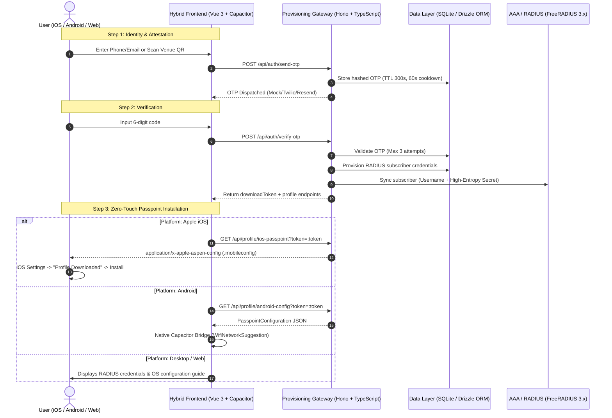

# Production-Grade Wi-Fi Passpoint (Hotspot 2.0) Onboarding System

A complete full-stack prototype for onboarding Wi-Fi subscribers via SMS/Email OTP, scanning venue QR codes, and provisioning zero-touch auto-connecting **Wi-Fi Passpoint (Hotspot 2.0 / Release 2)** profiles across **iOS**, **Android**, and **Generic Web**.

---

## 📑 Architecture Overview



---

## 📁 Repository Structure

```text
├── backend/                        # Hono + Node.js + TypeScript API
│   ├── src/
│   │   ├── config.ts               # Passpoint realm, OIs, RADIUS parameters
│   │   ├── index.ts                # Server entrypoint with CORS & logging
│   │   ├── db/
│   │   │   ├── schema.ts           # Drizzle ORM (users, otps, subscribers, devices)
│   │   │   └── index.ts            # LibSQL client & automatic table creation
│   │   ├── routes/
│   │   │   ├── auth.ts             # /send-otp and /verify-otp routes
│   │   │   └── profile.ts          # /ios-passpoint and /android-config routes
│   │   ├── services/
│   │   │   ├── otp.service.ts      # Cryptographic 6-digit OTP engine & rate limiter
│   │   │   ├── radius.service.ts   # RADIUS credentials generator
│   │   │   └── passpoint.service.ts# .mobileconfig & Android config builder
│   │   └── templates/
│   │       └── mobileconfig.xml.ts # Apple com.apple.wifi.managed plist generator
│   ├── test-integration.ts         # Direct unit/service integration test suite
│   ├── test-e2e-http.ts            # Live HTTP integration test suite
│   ├── package.json
│   └── tsconfig.json
├── frontend/                       # Vue 3 + Vite + Tailwind CSS + Capacitor
│   ├── src/
│   │   ├── api/
│   │   │   └── client.ts           # Platform detection & API client
│   │   ├── components/
│   │   │   ├── HeroScreen.vue      # Captive portal attraction screen
│   │   │   ├── AuthModal.vue       # Phone/Email input modal with country codes
│   │   │   ├── DialCodeSelect.vue  # International dial code dropdown
│   │   │   ├── QrScannerModal.vue  # @zxing camera QR scanner + mock fallback
│   │   │   ├── OtpVerification.vue # 6-digit split inputs + 60s cooldown timer
│   │   │   └── ConnectionSuccess.vue# Dynamic platform-aware install screen
│   │   ├── plugins/
│   │   │   └── passpointBridge.ts  # Capacitor native bridge / Web mock
│   │   ├── types/                  # TypeScript interface definitions
│   │   ├── App.vue                 # Onboarding state machine orchestrator
│   │   ├── main.ts
│   │   └── style.css
│   ├── capacitor.config.ts         # Capacitor export config
│   ├── tailwind.config.js
│   ├── package.json
│   └── vite.config.ts
├── native/
│   └── android/
│       └── PasspointPlugin.kt      # Native Android Kotlin Capacitor plugin
├── docker/
│   ├── docker-compose.yml          # FreeRADIUS + Backend + Frontend stack
│   └── freeradius/
│       ├── Dockerfile
│       ├── clients.conf            # AP/WLC client definition
│       ├── users                   # Radcheck test subscribers
│       └── eap.conf                # EAP-TTLS and MSCHAPv2 profile
├── package.json                    # Root workspace manager
└── README.md
```

---

## 🚀 Quickstart (Local Development)

### Prerequisites
- **Node.js**: v18+ (tested on Node 22 and 24)
- **npm**: v9+
- *(Optional)* **Docker**: for running the mock FreeRADIUS server

### 1. Install Dependencies
```bash
# Install backend dependencies
cd backend
npm install

# Install frontend dependencies
cd ../frontend
npm install
```

### 2. Run Integration Tests
Verify end-to-end OTP generation, verification, database persistence, and profile output:
```bash
cd backend
npx tsx test-integration.ts
npx tsx test-e2e-http.ts
```

### 3. Launch Development Servers
In two separate terminals:

**Terminal 1 — Backend (Port 3000):**
```bash
cd backend
npm run dev
```

**Terminal 2 — Frontend (Port 5173):**
```bash
cd frontend
npm run dev
```

Open your browser to: **`http://localhost:5173`**

---

## 📱 Platform Installation Specifications

### 1. Apple iOS (`.mobileconfig`)

#### MIME Type Requirement
iOS Safari requires the following HTTP response headers to trigger the native profile download prompt:
```http
Content-Type: application/x-apple-aspen-config; charset=utf-8
Content-Disposition: attachment; filename="passpoint-wifi.mobileconfig"
```
> [!IMPORTANT]
> If served with `application/xml` or `text/xml`, Safari will display raw XML instead of opening the profile installer.

#### Passpoint Payload Attributes
The generated configuration contains a `com.apple.wifi.managed` payload:
- `IsHotspot`: `true`
- `DisplayedOperatorName`: `FastPass Free Wi-Fi`
- `DomainName`: `wifi.example.com`
- `NAIRealm`: `wifi.example.com`
- `RoamingConsortiumList`: `['5A03BA0000', '004096']` (e.g. OpenRoaming)
- `EAPClientConfiguration`:
  - `AcceptEAPTypes`: `[21]` (*21 represents EAP-TTLS*)
  - `TTLSInnerAuthentication`: `MSCHAPv2`
  - `UserName`: Subscriber RADIUS username (`sub_xxxx`)
  - `UserPassword`: Generated secret
  - `OuterIdentity`: `anonymous@wifi.example.com`

#### Signing the Profile (Production)
Unsigned profiles display a yellow **"Unsigned"** badge in iOS Settings. To sign with a trusted SSL/TLS or Apple Developer Certificate:
```bash
openssl smime -sign \
  -in unsigned-profile.mobileconfig \
  -out signed-profile.mobileconfig \
  -signer server.crt \
  -inkey server.key \
  -certfile ca-chain.pem \
  -outform DER \
  -nodetach
```

---

### 2. Native Android (Hotspot 2.0 via Capacitor)

Android integrates Passpoint profiles at the OS network stack.

#### Native Implementation (`PasspointPlugin.kt`)
The repository includes a ready-to-use Capacitor Kotlin plugin in `native/android/PasspointPlugin.kt`:
- **Android 10+ (API 29+)**: Uses `WifiNetworkSuggestion.Builder().setPasspointConfig(passpointConfig).build()` and `wifiManager.addNetworkSuggestions()`.
- **Android 8.0 - 9.0 (API 26-28)**: Uses `wifiManager.addOrUpdatePasspointConfiguration(passpointConfig)`.

#### Required Permissions (`AndroidManifest.xml`)
```xml
<uses-permission android:name="android.permission.INTERNET" />
<uses-permission android:name="android.permission.ACCESS_NETWORK_STATE" />
<uses-permission android:name="android.permission.ACCESS_WIFI_STATE" />
<uses-permission android:name="android.permission.CHANGE_WIFI_STATE" />
<uses-permission android:name="android.permission.ACCESS_FINE_LOCATION" />
```

---

## 📡 Docker Compose Testing (FreeRADIUS + Services)

To run the entire ecosystem locally inside Docker:

```bash
cd docker
docker compose up --build
```

### Services Started:
| Service | Internal Port | Host Port | Description |
| :--- | :--- | :--- | :--- |
| **`freeradius`** | 1812/udp, 1813/udp | 1812, 1813 | FreeRADIUS 3.x with EAP-TTLS and MSCHAPv2 configured |
| **`backend`** | 3000 | 3000 | Hono Node.js API with SQLite database |
| **`frontend`** | 5173 | 5173 | Vue 3 + Tailwind onboarding portal |

### Testing RADIUS EAP-TTLS with `radtest` / `eapol_test`
```bash
# Test with eapol_test inside the freeradius container:
docker exec -it passpoint_freeradius radtest sub_test PasspointSecret2026! localhost 0 testing123
```

---

## 🛡️ Security Best Practices Implemented

1. **Cryptographically Secure OTP**: Generated via Node.js `crypto.randomInt(100000, 1000000)` with SHA-256 HMAC hashing.
2. **Brute-Force & Cooldown Protection**: 60-second minimum cooldown between OTP requests and max 3 verification attempts per session.
3. **Short-Lived Download Tokens**: `.mobileconfig` downloads use a 32-byte cryptographically random token valid for 60 minutes.
4. **Unique Per-Device Subscriber Credentials**: Every authentication generates an isolated RADIUS username and high-entropy 24-character secret.
5. **Inner-Tunnel Privacy**: Passpoint outer identity is set to `anonymous@<realm>` to prevent eavesdropping of subscriber identifiers over the air.

